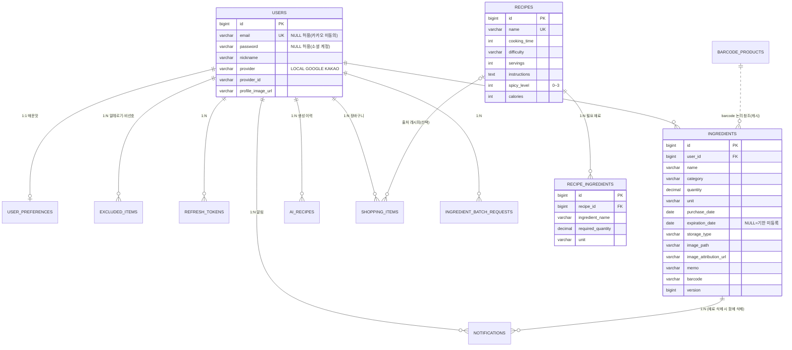

# DB 설계 (MySQL 8)

MySQL 8, UTF-8, 날짜 기준 Asia/Seoul. 스키마는 Flyway(`backend/src/main/resources/db/migration`)가 만들고 Hibernate `ddl-auto: validate`가 Entity와의 일치를 검사합니다.
**이미 적용한 마이그레이션은 수정하지 말고 다음 번호(V10~)로 추가하세요.**

| 버전 | 내용 |
| --- | --- |
| V1 | users, ingredients, recipes, recipe_ingredients |
| V2 | 샘플 레시피 16종 |
| V3 | 유통기한을 선택 값(NULL 허용)으로 |
| V4 | ingredient_batch_requests (일괄 등록 중복 방지) |
| V5 | 소셜 로그인(users 확장), refresh_tokens, user_preferences, excluded_items |
| V6 | 식재료 image_path·memo·barcode, barcode_products |
| V7 | recipes.spicy_level, PRD 샘플 레시피 이름 정리 + 5종 추가(총 21종) |
| V8 | ai_recipes, shopping_items, notifications |
| V9 | (MySQL 전용, `db/vendor/mysql`) Spring Batch 메타 테이블. H2 테스트 DB는 Spring Boot가 직접 초기화 |
| V10 | `barcode_products`에 브랜드·외부 상품 이미지 URL 캐시 추가 |
| V11 | 식재료 사진의 출처 URL 저장 |

## ERD

## 테이블 설명

| 테이블 | 핵심 |
| --- | --- |
| users | `UNIQUE(provider, provider_id)`. 이메일 로그인은 BCrypt 해시 저장. 소셜 계정은 password NULL. 카카오는 이메일 동의를 못 받을 수 있어 email도 NULL 허용(MySQL UNIQUE는 NULL 중복 허용). 검증되지 않은 이메일은 저장·연결하지 않음 |
| refresh_tokens | 원문이 아닌 SHA-256 해시, `family_id`로 로그인 세션 단위 폐기·재사용 감지 |
| user_preferences / excluded_items | 먹을 수 있는 최대 매운맛(행이 없으면 제한 없음), 알레르기·비선호 이름(`item_type`) |
| ingredients | 사용자별 재고. **D-Day·상태는 저장하지 않고 계산**. `image_path`는 서버가 만든 UUID 파일명만. `image_attribution_url`은 가져온 Open Food Facts 사진의 출처 링크. 수정 충돌 감지용 `version`(사진 교체는 버전을 올리지 않음) |
| recipes / recipe_ingredients | 공통 레시피와 필요 재료(기본 인분 기준 수량·단위). 재료는 이름 문자열 + 동의어 정규화(`IngredientNames`)로 매칭 |
| barcode_products | 바코드 → 품목명·브랜드·기본 유통기간·외부 상품 이미지 URL 조회 결과 캐시 |
| ai_recipes | AI 생성 결과(JSON). 검증 전 생성물이라 공통 recipes와 분리하고 사용자별로만 보관 |
| shopping_items | 앱 내 장바구니. `recipe_id`는 출처 추적용(NULL 허용) |
| notifications | 알림 큐. `UNIQUE(ingredient_id, type, notify_date)`로 배치 재실행에도 중복 없음 |
| ingredient_batch_requests | 일괄 등록 완료 기록(응답 유실 후 재시도 중복 방지) |
| BATCH_* | Spring Batch 6 작업 메타데이터 (`runDate`가 같은 작업은 한 번만 성공) |

## 관계 요약

- **1:N**: 사용자 → 재고·AI 레시피·장바구니·알림·Refresh Token·알레르기 항목, 레시피 → 필요 재료, 재료 → 알림
- **1:1**: 사용자 ↔ 설정
- **N:M**: 레시피 ↔ 재료 개념은 `recipe_ingredients`(연결 엔티티, 수량·단위 속성 보유)가 표현. 사용자 ↔ 레시피 즐겨찾기는 이번 범위에서 `ai_recipes.favorite`로 대신함(공통 레시피 즐겨찾기가 필요하면 `favorite_recipes(user_id, recipe_id)` 추가)
